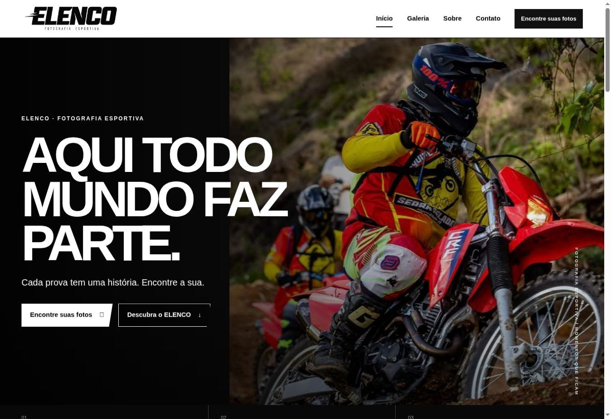
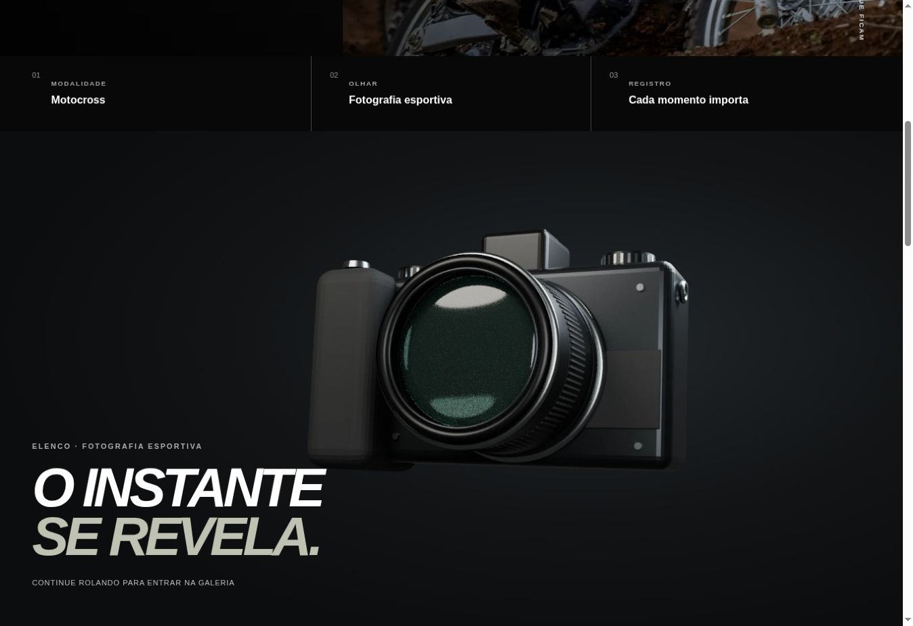

# Hero e câmera 3D

Base em `1c12b1acb5e97da34a67c92a11081dea88705d03`, após integração do hotfix #12. Branch `feat/camera-3d-hero-quality`.

## Foto inicial

O arquivo original do cliente tem 692 × 993 px. O Hero agora utiliza esse JPEG exato, com SHA-256 verificado em teste. No desktop, a área fotográfica ocupa 62% da largura, reduzindo a ampliação e o recorte da fonte vertical. Não foram gerados detalhes artificiais nem alterada a fotografia do acervo da galeria. Para resolução real superior à fonte recebida, será necessário um original maior.

## Câmera

A lente frontal foi substituída por câmera procedural volumétrica em perspectiva, com corpo de magnésio, empunhadura, borracha com microtextura, anéis estriados instanciados, controles, parafusos, seis lâminas e vidro óptico convexo. Iluminação com ambiente de estúdio PMREM, luz principal e contraluz, tone mapping ACES. Modelo, renderer e interface foram separados.

GSAP alinha a câmera antes da aproximação óptica, com scrub reversível. Imports continuam dinâmicos e próximos à viewport. DPR limitado a 1,5. Renderização ocorre na atualização do scroll e redimensionamento, sem loop contínuo. Contexto GSAP, geometrias, materiais, texturas, ambiente PMREM, instâncias e WebGL são liberados ao sair da Home. Alterar para largura mobile ou movimento reduzido remove a cena ativa. Perda do contexto aciona fallback.

O fallback é um render offline da mesma geometria, com iluminação Cycles. Não é captura da animação WebGL. A aparência de iluminação pode diferir entre os dois renderizadores. Regeneração opcional com `node scripts/render-camera-poster.mjs`, usando Blender 4.3+. O build do site não exige Blender. A versão estática pesa cerca de 61 KB e preserva a apresentação em mobile, economia de dados, memória reduzida, movimento reduzido e ausência de WebGL.

## Testes

Node 24.22.3. Executados `npm ci`, `npm run lint`, `npm run test:content` (8 testes), `npm run typecheck`, `npm run build` e `npm run test:navigation` (7 testes), todos aprovados. Exportação `out` das quatro rotas mantida. [CI aprovada](https://github.com/KiseStudios/tonoelenco/actions/runs/45473782590).

## Navegador

Prévia examinada em `https://bfe7e38c.tonoelenco.pages.dev/`, desktop 1363 × 936. Foto original e poster da câmera carregados. O WebGL do navegador retornou `GL_RENDERER = Disabled`, mantendo a navegação por fallback. Esses erros de inicialização são emitidos pelo Three e tratados pelo componente.

Breakpoint responsivo conferido com zoom nativo em viewport CSS 454 × 312. Documento sem overflow horizontal. Menu abriu, fechou com Escape, CTA levou a `/galeria` e lightbox abriu e fechou com Escape. Zoom restaurado ao finalizar. Esse teste não equivale a validação em aparelho físico de 390 px.

## Pendências de revisão

O Chromium local não iniciou neste ambiente e o navegador remoto tem WebGL desabilitado. A renderização offline confirma a geometria, sem comprovar a execução WebGL. Luan deve conferir a aproximação, reversão, mudança de preferência, perda de contexto, saída da Home e desempenho em navegador com WebGL ativo. Não há medição de FPS nem teste em hardware físico. Sem merge automático ou mudança de produção.
