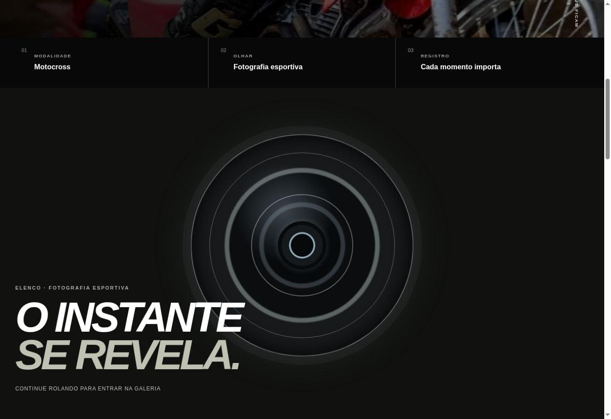
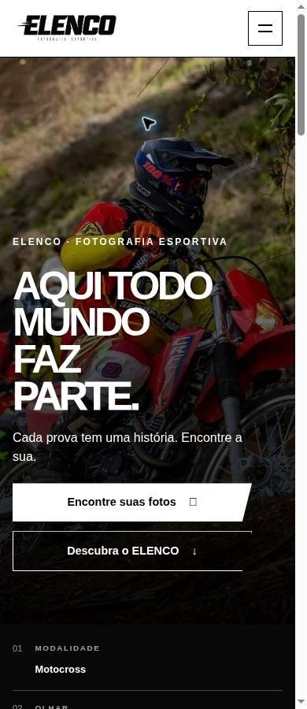
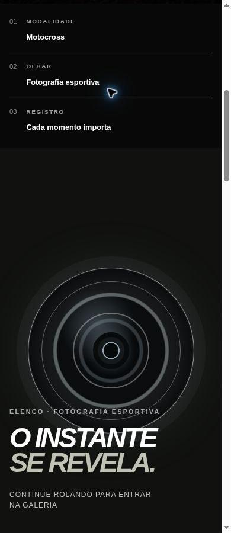
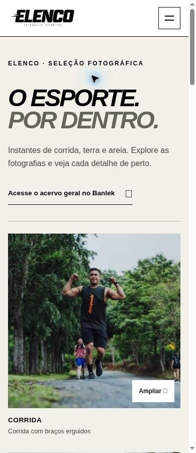

# Revisão do hotfix PR-008

## Base e diagnóstico

Main atualizada com `git fetch origin`, em `596df5ae04feeaf90c3b0d9af5a2cf4080b5b7e8`, com os PRs GitHub #10 e #11 incorporados. Branch `fix/pr-008-typescript-threejs` criada dessa base.

O `npm run typecheck` reproduziu os sete erros da execução [45467987412](https://github.com/KiseStudios/tonoelenco/actions/runs/45467987412). As referências opcionais de inicialização não tinham estreitamento suficiente e a interface `TimelineLike` não declarava `to`. O arquivo `src/types/three.d.ts` declarava o módulo Three sem os tipos reais.

## Correção

- Referências locais constantes `activeScene`, `activeRenderer` e `activeTimeline` durante a inicialização e os callbacks, com referências externas preservadas para descarte.
- Tipos `Scene`, `WebGLRenderer`, `Mesh`, `Object3D` e `gsap.core.Timeline` das bibliotecas.
- `@types/three` 0.180.0 para Three 0.180.0, com lockfile atualizado e remoção da declaração genérica.
- Verificação estrutural `isMesh` para descartar geometrias e materiais com os tipos reais.
- Sem `any`, `@ts-ignore` ou alteração de geometria, seis lâminas, materiais, valores de animação, política de fallback, imports dinâmicos ou configuração de produção.

## Testes técnicos

Executados localmente com Node 24.22.3 e npm 11.19.1, compatível com `.nvmrc` 24 e `engines` do projeto.

| Comando | Resultado |
| --- | --- |
| `npm ci` | Aprovado, 371 pacotes instalados |
| `npm run lint` | Aprovado |
| `npm run test:content` | Aprovado, 7 testes |
| `npm run typecheck` | Aprovado |
| `npm run build` | Aprovado |
| `npm run test:navigation` | Aprovado, 7 testes sobre o HTML exportado |

Exportação estática preservada em `next.config.ts`, com `output: "export"` e imagens não otimizadas. Confirmados os arquivos `out/index.html`, `out/galeria.html`, `out/sobre.html` e `out/contato.html`. A suíte de navegação valida o HTML exportado, sem equivaler a um teste E2E.

## Verificação no navegador

Prévia Cloudflare do código corrigido [a2962207.tonoelenco.pages.dev](https://a2962207.tonoelenco.pages.dev), commit `ddde261`. As capturas abaixo são reais. Recorte apenas das margens externas do iframe nos testes responsivos.

- Desktop com viewport 1363 × 936. Home e assets carregados. Ao aproximar a transição, o navegador recusou a criação de contexto WebGL (`GL_RENDERER = Disabled`). O componente permaneceu em `data-mode="fallback"`, exibindo a lente CSS e permitindo continuar até as fotografias.
- Mobile em iframe de 390 × 900. Menu aberto e fechado com Escape, navegação do menu para `/galeria`, lightbox da Home aberto e fechado com Escape. Lente em fallback sem inicializar o engine Three, conforme a política existente para larguras inferiores a 768 px.
- O teste adicional de movimento reduzido com HTML exportado isolado foi inconclusivo, pois essa cópia não carregou os estilos da prévia corretamente. Não foi considerado aprovado. A política `prefers-reduced-motion` permanece inalterada no código.
- Console do teste desktop registrou os erros do Three ao tentar criar o contexto WebGL indisponível, tratados pelo fallback. No teste mobile não foram observados erros da aplicação. Erros internos da extensão de automação foram excluídos dessa avaliação.

Arquivos temporários de suporte à revisão foram removidos antes da entrega. Nenhum simulador permanece na aplicação final.

### Capturas

## Pendências para Luan

A aproximação 3D, abertura do diafragma durante a animação, reversão do ScrollTrigger, desempenho e descarte de um contexto WebGL efetivamente criado precisam ser conferidos em navegador com WebGL disponível. Este ambiente não permitiu executar esses testes visuais. Não há medição de FPS nem validação em aparelhos físicos.

Na prévia final do PR, rolar até a lente em desktop com WebGL ativo, avançar e retornar pela transição, redimensionar a janela e navegar até a galeria. Conferir console e ausência de recursos WebGL após sair da Home. Conferir também preferência real de movimento reduzido e mobile físico. O código e os parâmetros da animação original foram preservados.

Sem merge automático e sem início do PR-010.
